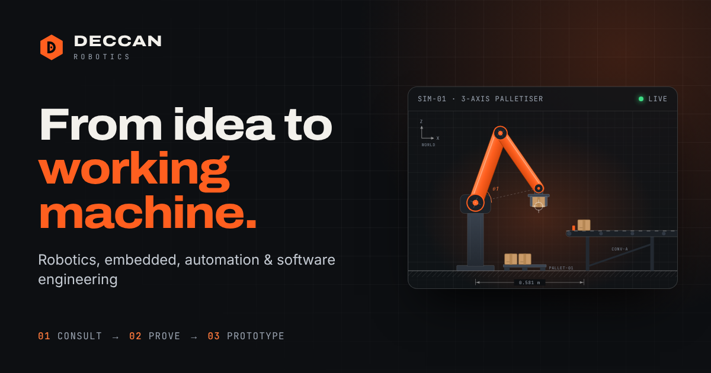

# Deccan Robotics — website

Website for **Deccan Robotics** ([deccanrobotics.in](https://deccanrobotics.in)), an engineering studio for robotics, embedded systems, industrial automation and software development. The studio offers consulting, proofs of concept and prototyping.



- **Fast and static.** Built with [Astro](https://astro.build). It ships no UI framework and only a few kilobytes of JavaScript. Lighthouse (mobile): Performance 97–99, Accessibility 100, Best Practices 100, SEO 100.
- **Interactive hero.** A live 3-axis robot arm solves inverse kinematics every frame to palletise boxes from a conveyor. Visitors can take control with the mouse, or tap a target on a phone.
- **Animated illustrations, no image files.** A mobile robot follows an A\* path, signals pulse across a PCB, a vision station inspects parts on a conveyor, and a build pipeline runs next to a live dashboard. All of it is SVG and CSS.
- **Accessible.** Uses semantic HTML, works fully with a keyboard and passes an axe-core scan with 0 violations. Animations are disabled for visitors who choose *reduced motion*.
- **SEO-ready.** Includes Open Graph and Twitter cards, JSON-LD structured data, a sitemap, robots.txt and canonical URLs.

## Quick start

Requires **Node.js 22.23 or newer** (see `.nvmrc`).

```bash
npm install
npm run dev        # http://localhost:4321
npm run build      # production build in ./dist
npm run preview    # serve the production build locally
npm run check      # TypeScript / Astro diagnostics
```

## Contact details and the enquiry form

Contact details live in [`src/config.ts`](src/config.ts):

- `email` — main contact shown across the site (currently `vishal@deccanrobotics.in`)
- `supportEmail` — client support (currently `support@deccanrobotics.in`)
- `phone` — shown in the footer and on the contact page
- `location.city`, `socials` — optional; empty values are hidden

### Receiving project enquiries

By default the **Project enquiry** form opens the visitor's own email app with the message filled in and addressed to `email`. To have every enquiry delivered straight to your inbox instead:

1. Go to [web3forms.com](https://web3forms.com), choose **Create your Access Key**, and enter the inbox that should receive enquiries (e.g. `vishal@deccanrobotics.in`).
2. Copy the access key from the email Web3Forms sends you.
3. Paste it into `form.web3formsKey` in `src/config.ts`, then commit and push. The site redeploys automatically.

Each enquiry then arrives as an email with all the form answers, and **Reply** goes straight to the visitor. The access key is designed to be public, so it is safe to commit. Any other form service that accepts POSTs (e.g. Formspree) works too: put its URL in `form.endpoint`.

## Before you go live ✅

1. **Domain:** the GitHub Pages workflow picks up the custom domain automatically. For other hosts, set the `SITE_URL` environment variable (defaults to `https://deccanrobotics.in`).
2. **Social links:** add LinkedIn, GitHub, X or YouTube URLs in `src/config.ts`.
3. **Review the copy:** check the typical durations, the tools and platforms list, and the policy statements (NDA, IP ownership, pricing approach, reply time) so they match how you actually work.

## Editing content

| What | Where |
| --- | --- |
| Company settings (email, phone, socials, form) | `src/config.ts` |
| Service pages (Robotics, Embedded, Automation, Software) | `src/data/services.ts` |
| Engagement models, process, capability layers, industries, principles, FAQs, tools list | `src/data/content.ts` |
| Home page section order | `src/pages/index.astro` |
| Colours, typography, spacing | `src/styles/global.css` (design tokens at the top) |
| Logo | `src/components/ui/Logo.astro` (+ run `npm run assets` to refresh icons) |

Service pages are generated from `src/data/services.ts`. Adding an entry there creates a new page at `/services/<slug>/`.

### Project structure

```text
src/
├── components/
│   ├── home/            # Home-page sections (Hero, RobotArm, Process, LayerStack, …)
│   ├── illustrations/   # Animated SVG illustrations (AMR map, PCB, conveyor, software stack, basalt columns)
│   ├── ui/              # Reusable pieces (Icon, Logo, PageHero, Faq, CtaBand, …)
│   ├── Header.astro
│   └── Footer.astro
├── data/                # All site copy lives here
├── layouts/BaseLayout.astro   # <head>, SEO meta, JSON-LD, fonts
├── lib/                 # URL helpers, icon registry, contour generator, schema helpers
├── pages/               # One file per route (+ services/[slug].astro)
├── scripts/reveal.ts    # Scroll reveal + pausing off-screen animations
└── styles/global.css    # Design system
public/                  # Favicons, social image, web manifest
scripts/generate-assets.cjs    # Regenerates favicons + social image (optional)
```

## Deployment

### GitHub Pages (included)

The workflow in `.github/workflows/deploy.yml` builds and publishes the site on every push to `main`.

1. In the repository go to **Settings → Pages → Build and deployment** and set **Source** to **GitHub Actions**.
2. Push to `main`, or re-run the workflow from the **Actions** tab.
3. The site appears at `https://<user>.github.io/<repo>/`. To use your own domain (e.g. `deccanrobotics.in`), add it under **Settings → Pages → Custom domain**, point the domain's DNS at GitHub, then re-run the workflow so links and the sitemap use the new address.

> GitHub Pages on a **private** repository needs a paid GitHub plan. On a free plan, make the repository public, or use one of the hosts below.

### Netlify, Vercel or Cloudflare Pages

Import the repository and use:

- **Build command:** `npm run build`
- **Output directory:** `dist`
- **Environment variable:** `SITE_URL=https://your-domain.com`

### Any other web host

Run `npm run build` and upload the contents of `dist/`.

## Regenerating icons and the social image

The generated files are committed, so you only need this after changing the logo, colours or headline:

```bash
npm run build
npm i -D playwright && npx playwright install chromium
npm run assets
```

## Credits

Icons: [Lucide](https://lucide.dev) (ISC). Fonts: [Archivo](https://fonts.google.com/specimen/Archivo), [Inter](https://rsms.me/inter/) and [JetBrains Mono](https://www.jetbrains.com/lp/mono/) (SIL Open Font License), self-hosted via Fontsource.
